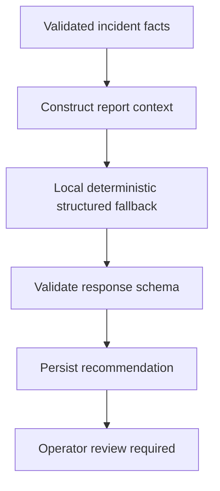

# AI analysis workflow

The current service does not call Gemini, infer facts from images, or execute tools.
The LangGraph/RAG, citation retrieval, Gemini adapter, and image analysis remain
unimplemented work. AI output is explicitly uncertain and never dispatches a team.
