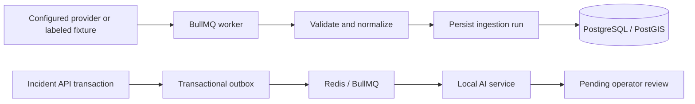

# Data and event workflow

Synthetic fixtures are clearly marked in database rows. External IMD, NASA GPM,
OpenStreetMap, and historical-data adapters are extension points, not currently
connected live providers.
