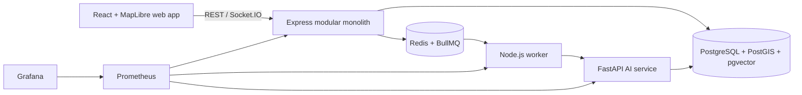

# System architecture

The API is the application boundary and the database is the source of truth. Redis
only transports retryable background work. Risk calculations are explainable and
versioned; local sample data and simulations are explicitly labelled.
