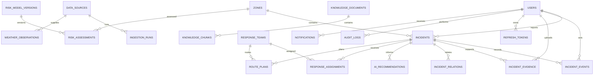

# Database model



Spatial columns use SRID 4326: incident/facility locations are `geography(POINT)`,
zone boundaries are `geometry(MULTIPOLYGON)`, roads are `geometry(LINESTRING)`, and
environment grid cells are `geometry(POLYGON)`. GiST indexes support bounding-box and
nearby-feature lookups; B-tree indexes cover incident status/time, reporter/time,
risk zone/time, and incident event/time. Vector similarity uses a 384-dimensional
pgvector column with an HNSW cosine index.

Representative spatial query (distance returned in metres):

```sql
SELECT f.name, ST_Distance(f.location, i.location) AS distance_m
FROM facilities f
JOIN incidents i ON i.id = $1
ORDER BY f.location <-> i.location
LIMIT 5;
```
